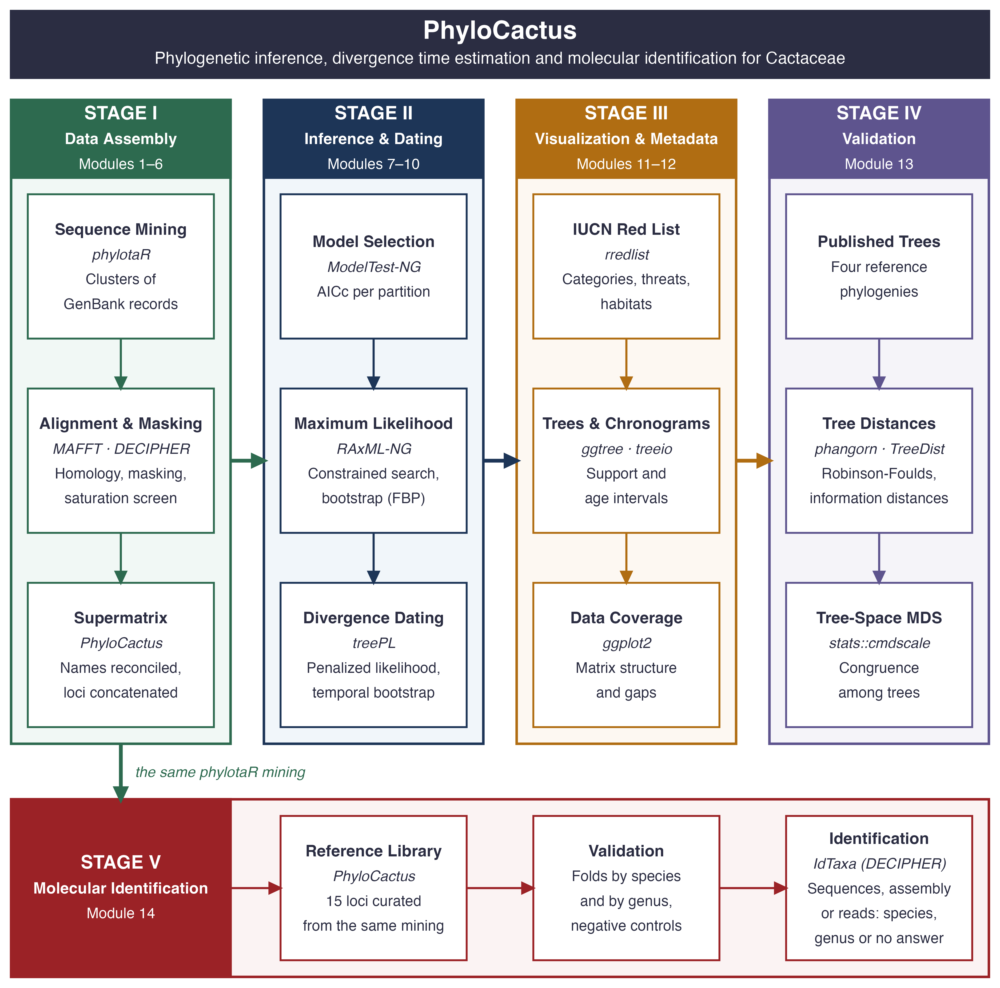

# PhyloCactus 

<!-- badges: start -->

[](https://lifecycle.r-lib.org/articles/stages.html#experimental) [](https://github.com/beeamerino/PhyloCactus/actions/workflows/R-CMD-check.yaml)

<!-- badges: end -->

**Reproducible R workflows for multilocus data assembly, evolutionary modeling, maximum-likelihood inference, and divergence time estimation in Cactaceae**

## Overview

Multilocus sequence datasets assembled from public repositories such as GenBank inherit the heterogeneity of decades of deposition: inconsistent locus annotations, duplicated accessions, records without vouchers, orthographic variants and nomenclatural synonyms. Converting these records into a phylogenetic matrix requires taxonomic curation and quality control of each alignment.

The difficulty increases in plant lineages that diversified recently and rapidly. Low plastid divergence, incomplete lineage sorting (ILS) and reticulate evolution increase the risk of erroneous orthology assessment and alignment error, and both can bias the inferred topology.

**Cactaceae** combine these properties. The family is one of the largest succulent radiations of the Neotropics (Arakaki *et al*., 2011; Hernández-Hernández *et al*., 2014; Guerrero *et al*., 2019), and its GenBank record is irregular in taxonomic and locus coverage.

`PhyloCactus` is an R package that implements this assembly and analysis as a reproducible workflow. It links established software in stages: orthology-based sequence retrieval (`phylotaR`), multiple sequence alignment (`MAFFT`), alignment masking (`DECIPHER`), a saturation screen, substitution model selection (`ModelTest-NG`), constrained maximum-likelihood inference (`RAxML-NG`), Felsenstein bootstrap proportions (FBP), penalized likelihood dating (`treePL`), retrieval of IUCN Red List assessments (`rredlist`), and comparison with published phylogenies.

`PhyloCactus` can also identify samples of cacti by DNA barcoding: from the same mining it builds a reference library of Sanger marker records, validates it, and identifies a sample (sequences, an assembly or Illumina reads) against it, locus by locus.

## Workflow

The workflow comprises fourteen modules grouped in five stages.



1.  **Stage 1: Data Assembly and Preparation (Modules 1 to 6)**\
    Retrieves orthologous sequence clusters from GenBank by similarity-based clustering with `phylotaR`, which reduces the dependence on locus annotations. Aligns each locus with `MAFFT` and masks unreliable alignment columns with `DECIPHER`. Checks species names against the Caryophyllales.org checklist (Korotkova *et al*., 2021) by matching them to accepted names only. Finally, realigns ingroup (Cactaceae) and outgroup (*Portulaca*, *Anacampseros*, *Talinopsis*, *Grahamia*, *Talinum*, *Talinella*) sequences jointly, and concatenates the loci into a partitioned supermatrix.

2.  **Stage 2: Phylogenetic Inference and Dating (Modules 7 to 10)**\
    Selects a substitution model for each partition with `ModelTest-NG` under the corrected Akaike information criterion (AICc). Infers the maximum-likelihood tree with `RAxML-NG` under a topological constraint (`cactus_constraints.csv`) that fixes 34 of the 1205 internal bipartitions of the reference tree. The constraint imposes the monophyly in 15 nodes of Cactaceae and 6 outgroup genera, and the branching order among Cactoideae and Opuntioideae; the remaining 1171 bipartitions are estimated. Node support is estimated with Felsenstein bootstrap proportions (FBP), with the transfer bootstrap expectation (TBE) as a secondary measure. Divergence times are estimated by penalized likelihood in `treePL` with one secondary calibration, a fixed age on the crown of the ACP clade (`calibrations_bounds.csv`), and their confidence intervals from temporal bootstrap replicates.

3.  **Stage 3: Visualization and Metadata Integration (Modules 11 and 12)**\
    Adds species-level IUCN Red List assessments retrieved with `rredlist` and produces the tree, chronogram and conservation figures with `ggplot2` and `ggtree`. Tutorial 3 draws every node with its FBP; `integrate_publication_tree()` collapses internal nodes with FBP \< 70 (`collapse_cutoff = 0.70`) into soft polytomies for data visualization.

4.  **Stage 4: Validation (Module 13)**\
    Compares the focal tree with published phylogenies (Amaral *et al*., 2022; Thompson *et al*., 2024; Zuntini *et al*., 2024; de Vos *et al*., 2025; Carruthers *et al*., 2026) by Robinson-Foulds and information-theoretic distances and by multidimensional scaling (MDS) of tree space (`validate_phylogenies()`).

5.  **Stage 5: Molecular identification (Module 14)**\
    Builds a reference library of 15 loci from the same phylotaR mining retrieved in Stage 1, validates it with folds that ask for the species or, with the species left out, for the genus, with negative controls, and identifies a sample locus by locus with `IdTaxa` (Murali *et al*., 2018) in three states: species, genus or no answer. Each identification writes an HTML report (Tutorial 6 identifies samples of each kind of input).

## Installation

Install the development version from GitHub:

``` r
if (!requireNamespace("remotes", quietly = TRUE))
  install.packages("remotes")

remotes::install_github("beeamerino/PhyloCactus")
```

Check the installed version:

``` r
library(PhyloCactus)

packageVersion("PhyloCactus")
```

## R Dependencies

| Repository | Main packages |
|:-----------------------------------|:-----------------------------------|
| **GitHub** | `phylotaR` |
| **Bioconductor** | `DECIPHER`, `Biostrings`, `ggtree` |
| **CRAN** | `ape`, `phangorn`, `TreeDist`, `ggplot2`, `dplyr`, `tidyr`, `readr`, `stringr`, `purrr`, `rredlist` |

The Bioconductor dependencies are installed with:

``` r
if (!requireNamespace("BiocManager", quietly = TRUE))
    install.packages("BiocManager")

BiocManager::install(c("DECIPHER", "Biostrings", "ggtree"))
```

## External Software

The following software must be installed and available on the system `PATH`, or declared in `~/.Renviron` (`usethis::edit_r_environ()`). The version column gives the version used by the reference run of October 2026; the package does not check which versions are installed.

| Software | Version of the reference run | Purpose | Needed in | Citation |
|:--------------|:--------------|:--------------|:--------------|:--------------|
| [`BLAST+`](https://www.ncbi.nlm.nih.gov/books/NBK279690/) | 2.17.0 | Sequence similarity search for cluster identification | Tutorial 1 | Camacho *et al*. (2009) *BMC Bioinformatics* |
| [`MAFFT`](https://mafft.cbrc.jp/alignment/software/) | 7.526 | Multiple sequence alignment | Tutorials 1 and 5 | Katoh & Standley (2013) *Mol. Biol. Evol.* |
| [`ModelTest-NG`](https://github.com/ddarriba/modeltest) | 0.1.7 | Substitution model selection for partitioned data | Tutorial 2 | Darriba *et al*. (2020) *Mol. Biol. Evol.* |
| [`RAxML-NG`](https://github.com/amkozlov/raxml-ng) | 1.2.2 | Constrained maximum-likelihood inference and bootstrap support | Tutorial 2 | Kozlov *et al*. (2019) *Bioinformatics* |
| [`treePL`](https://github.com/blackrim/treePL) | build 2022.04.06 of brewsci/bio | Penalized likelihood divergence time estimation | Tutorial 2 | Smith & O'Meara (2012) *Bioinformatics* |
| [`TreeAnnotator`](https://www.beast2.org/treeannotator/) | 2.7.7 (BEAST 2.7) | Summary of the dated replicates; run outside the package | Tutorial 2 | Bouckaert *et al*. (2019) *PLoS Comput. Biol.* |
| [`fastp`](https://github.com/OpenGene/fastp) | 1.3.7 | Read trimming before organelle assembly (identification from Illumina reads only) | Tutorials 5 and 6 | Chen *et al*. (2018) *Bioinformatics* |
| [`GetOrganelle`](https://github.com/Kinggerm/GetOrganelle) | 1.7.7.1 | Assembly of the plastome and nuclear ribosomal DNA from reads (identification from Illumina reads only) | Tutorials 5 and 6 | Jin *et al*. (2020) *Genome Biol.* |
| [`minimap2`](https://github.com/lh3/minimap2) | 2.31-r1302 | Mapping of the library loci onto an assembly (identification from an assembly only) | Tutorials 5 and 6 | Li (2018) *Bioinformatics* |
| [`samtools`](https://github.com/samtools/samtools) | 1.24 | Extraction of the mapped regions (identification from an assembly only) | Tutorials 5 and 6 | Danecek *et al*. (2021) *GigaScience* |
| `ASTRAL-III`, with Java | not run by the reference run, which used the distributed summary tree | Optional species-tree summary of the published gene trees | Tutorial 4 (optional step) | Zhang *et al*. (2018) *BMC Bioinformatics* |

## Data Obtained by the User

The checklist of Cactaceae of Caryophyllales.org is not distributed with the package. Request it from the team of Caryophyllales.org (<https://caryophyllales.org>) and set the path of the Excel workbook in `~/.Renviron` as `PHYLOCACTUS_CHECKLIST`. `phylocactus_checklist()` returns it to every module that reads the checklist.

The IUCN Red List assessments of Tutorial 3 are retrieved with the user's own token (`IUCN_REDLIST_KEY`), and the four published trees compared in Tutorial 4 are read from the folder in `PHYLOCACTUS_REFERENCE_TREES` (sources in Tutorial 4). The package distributes the IUCN Red List category of each species and counts by country, threat class and habitat class, not the assessments or their occurrences.

## Documentation

| Tutorial | Content |
|:-----------------------------------|:-----------------------------------|
| [**Get Started**](https://beeamerino.github.io/PhyloCactus/articles/PhyloCactus.html) | Package overview, design and dependency configuration |
| [**Tutorial 1**](https://beeamerino.github.io/PhyloCactus/articles/tutorial-1-cactus-phylogeny-prep.html) | Stage 1: data assembly, alignment, saturation screen and supermatrix concatenation |
| [**Tutorial 2**](https://beeamerino.github.io/PhyloCactus/articles/tutorial-2-cactus-phylogeny-inference.html) | Stage 2: substitution models, constrained maximum-likelihood search, bootstrap support and `treePL` dating |
| [**Tutorial 3**](https://beeamerino.github.io/PhyloCactus/articles/tutorial-3-cactus-phylogeny-visualization.html) | Stage 3: IUCN Red List data, collapse of weakly supported nodes and figures |
| [**Tutorial 4**](https://beeamerino.github.io/PhyloCactus/articles/tutorial-4-cactus-phylogeny-validation.html) | Stage 4: tree distances, MDS of tree space and the optional `ASTRAL-III` reference summary |
| [**Tutorial 5**](https://beeamerino.github.io/PhyloCactus/articles/tutorial-5-cactus-phylogeny-barcoding.html) | Stage 5 (Module 14): the reference library and its validation |
| [**Tutorial 6**](https://beeamerino.github.io/PhyloCactus/articles/tutorial-6-cactus-barcoding-identification.html) | Stage 5 (Module 14): identifying a sample, with worked examples of each kind of input, the report, and the rates measured with this version |
| [**Function Reference**](https://beeamerino.github.io/PhyloCactus/articles/tutorial-7-cactus-phylogeny-functions.html) | Package functions and the methods they implement |

## Citation

To cite `PhyloCactus`, use the entry returned by:

``` r
citation("PhyloCactus")
```

## References

- Amaral *et al*., 2022. Spatial patterns of evolutionary diversity in Cactaceae show low ecological representation within protected areas. *Biological Conservation*, 273, 109677. <https://doi.org/10.1016/j.biocon.2022.109677>
- Arakaki *et al*., 2011. Contemporaneous and recent radiations of the world's major succulent plant lineages. *PNAS*, 108(20), 8379–8384. <https://doi.org/10.1073/pnas.1100628108>
- Bouckaert *et al*., 2019. BEAST 2.5: an advanced software platform for Bayesian evolutionary analysis. *PLoS Computational Biology*, 15(4), e1006650. <https://doi.org/10.1371/journal.pcbi.1006650>
- Camacho *et al*., 2009. BLAST+: architecture and applications. *BMC Bioinformatics*, 10, 421. <https://doi.org/10.1186/1471-2105-10-421>
- Carruthers *et al*., 2026. A large phylogenetic tree for euphyllophytes. *Applications in Plant Sciences*, e70092. <https://doi.org/10.1002/aps3.70092>
- Chen *et al*., 2018. fastp: an ultra-fast all-in-one FASTQ preprocessor. *Bioinformatics*, 34(17), i884–i890. <https://doi.org/10.1093/bioinformatics/bty560>
- Danecek *et al*., 2021. Twelve years of SAMtools and BCFtools. *GigaScience*, 10(2), giab008. <https://doi.org/10.1093/gigascience/giab008>
- Darriba *et al*., 2020. ModelTest-NG: a new and scalable tool for the selection of DNA and protein evolutionary models. *Molecular Biology and Evolution*, 37(1), 291–294. <https://doi.org/10.1093/molbev/msz189>
- Guerrero *et al*., 2019. Phylogenetic relationships and evolutionary trends in the cactus family. *Journal of Heredity*, 110(1), 4–21. <https://doi.org/10.1093/jhered/esy064>
- Hernández-Hernández *et al*., 2014. Beyond aridification: multiple explanations for the elevated diversification of cacti in the New World Succulent Biome. *New Phytologist*, 202(4), 1382–1397. <https://doi.org/10.1111/nph.12752>
- Jin *et al*., 2020. GetOrganelle: a fast and versatile toolkit for accurate de novo assembly of organelle genomes. *Genome Biology*, 21, 241. <https://doi.org/10.1186/s13059-020-02154-5>
- Katoh & Standley, 2013. MAFFT multiple sequence alignment software version 7: improvements in performance and usability. *Molecular Biology and Evolution*, 30(4), 772–780. <https://doi.org/10.1093/molbev/mst010>
- Korotkova *et al*., 2021. Cactaceae at Caryophyllales.org – a dynamic online species-level taxonomic backbone for the family. *Willdenowia*, 51(2), 251–270. <https://doi.org/10.3372/wi.51.51208>
- Kozlov *et al*., 2019. RAxML-NG: a fast, scalable and user-friendly tool for maximum likelihood phylogenetic inference. *Bioinformatics*, 35(21), 4453–4455. <https://doi.org/10.1093/bioinformatics/btz305>
- Li, 2018. Minimap2: pairwise alignment for nucleotide sequences. *Bioinformatics*, 34(18), 3094–3100. <https://doi.org/10.1093/bioinformatics/bty191>
- Murali *et al*., 2018. IDTAXA: a novel approach for accurate taxonomic classification of microbiome sequences. *Microbiome*, 6, 140. <https://doi.org/10.1186/s40168-018-0521-5>
- Smith & O’Meara, 2012. treePL: divergence time estimation using penalized likelihood for large phylogenies. *Bioinformatics*, 28(20), 2689–2690. <https://doi.org/10.1093/bioinformatics/bts492>
- Thompson *et al*., 2024. Identifying the multiple drivers of cactus diversification. *Nature Communications*, 15(1), 7282. <https://doi.org/10.1038/s41467-024-51666-2>
- de Vos *et al*., 2025. Phylogenomics and classification of Cactaceae based on hundreds of nuclear genes. *Plant Systematics and Evolution*, 311(5), 28. <https://doi.org/10.1007/s00606-025-01948-z>
- Zhang *et al*., 2018. ASTRAL-III: polynomial time species tree reconstruction from partially resolved gene trees. *BMC Bioinformatics*, 19(Suppl 6), 153. <https://doi.org/10.1186/s12859-018-2129-y>
- Zuntini *et al*., 2024. Phylogenomics and the rise of the angiosperms. *Nature*, 629(8013), 843–850. <https://doi.org/10.1038/s41586-024-07324-0>

## License

`PhyloCactus` is distributed under the MIT License.