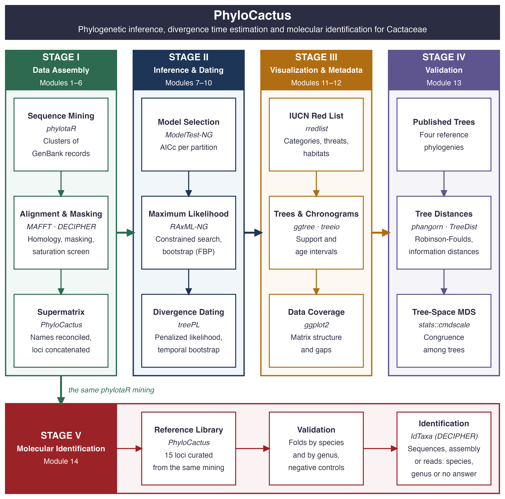

```{r setup, include = FALSE}
knitr::opts_chunk$set(
  collapse = TRUE,
  comment = "#>"
)
```
## Overview

`PhyloCactus` is an R package for assembling, curating and analyzing multilocus sequence datasets built from public DNA sequences. It covers sequence retrieval from GenBank, quality control, phylogenetic inference, divergence time estimation, visualization and comparison with published phylogenies.

Multilocus datasets assembled from GenBank inherit the heterogeneity of decades of deposition: inconsistent locus annotations, duplicated accessions, records without vouchers, orthographic variants and nomenclatural synonyms. Converting these records into a phylogenetic matrix requires taxonomic curation against an accepted checklist (Korotkova *et al*., 2021), and quality control of each alignment. The difficulty increases in plant lineages that diversified recently and rapidly, where low plastid divergence, incomplete lineage sorting (ILS) and reticulate evolution increase the risk of erroneous orthology assessment and of alignment error.

**Cactaceae**, one of the largest succulent radiations of the Neotropics combine these properties, and their GenBank record is irregular in taxonomic and locus coverage. `PhyloCactus` was developed on this family and implements its assembly and analysis as a reproducible workflow.

## Design

Each analytical step relies on established software, but chaining those programs by hand requires ad hoc scripts in which parameters, intermediate files and decisions are easily lost. `PhyloCactus` wraps each step in a function with explicit arguments and documented outputs, and the outputs of one module are the inputs of the next. Every module writes its parameters and results to disk, so that an analysis can be traced from the retrieved sequences to the final chronogram and resumed from any completed module.

## Workflow

The workflow comprises fourteen modules grouped in five stages.

```{r workflow-fig, echo=FALSE, out.width="100%", fig.align="center", fig.cap="**Figure 1.** Conceptual framework of the PhyloCactus pipeline: the phylogeny (Stages 1 to 4, Modules 1 to 13) and molecular identification (Stage 5, Module 14)."}
 
```

1. **Data Assembly and Preparation (Modules 1 to 6)**: retrieval of orthologous sequence clusters with `phylotaR`, alignment with `MAFFT`, masking of unreliable alignment regions with `DECIPHER`, a saturation screen, taxonomic check against the Caryophyllales.org checklist, and concatenation into a partitioned supermatrix.
2. **Phylogenetic Inference and Dating (Modules 7 to 10)**: substitution model selection per partition with `ModelTest-NG` under AICc, constrained maximum-likelihood inference with `RAxML-NG`, Felsenstein bootstrap proportions (FBP), temporal bootstrap replicates, and penalized likelihood dating with `treePL`.
3. **Visualization and Metadata Integration (Modules 11 and 12)**: IUCN Red List assessments retrieved with `rredlist`, and tree, chronogram and conservation figures. Tutorial 3 draws every node with its FBP; `integrate_publication_tree()`, which Tutorial 3 does not call, collapses nodes with FBP < 70 (`collapse_cutoff = 0.70`) into soft polytomies for data visualization.
4. **Validation (Module 13)**: Robinson-Foulds and information-theoretic distances and multidimensional scaling (MDS) of tree space (`validate_phylogenies()`) against published phylogenies.
5. **Molecular identification (Module 14)**: builds a reference library of 15 loci from the same phylotaR mining in Stage 1, validates it, and identifies a sample (sequences, an assembly or Illumina reads) against it, locus by locus, in three states: species, genus or no answer.

Each stage can be run on its own, from the outputs of the previous one.

## Installation

### Install PhyloCactus

Install the development version directly from GitHub:

``` r
if (!requireNamespace("remotes", quietly = TRUE))
  install.packages("remotes")

remotes::install_github("beeamerino/PhyloCactus")
```

Verify that the package has been installed:

``` r
library(PhyloCactus)

packageVersion("PhyloCactus")
```

### Configuring the System PATH

If R does not find an executable, add its installation directory to `PATH` in `.Renviron`:

``` r
usethis::edit_r_environ()
```

For example:

``` bash
PATH="/path/to/**your-app**/bin:${PATH}"
```

Restart the R session after saving the file.

### R Package Dependencies

`PhyloCactus` depends on packages from CRAN, Bioconductor and GitHub:

| Repository | Main packages |
|:-----------------------------------|:-----------------------------------|
| **GitHub** | `phylotaR` |
| **Bioconductor** | `DECIPHER`, `Biostrings`, `ggtree` |
| **CRAN** | `ape`, `phangorn`, `TreeDist`, `ggplot2`, `dplyr`, `tidyr`, `readr`, `stringr`, `purrr`, `rredlist` |

Install the Bioconductor packages with:

``` r
if (!requireNamespace("BiocManager", quietly = TRUE))
    install.packages("BiocManager")

BiocManager::install(c("DECIPHER", "Biostrings", "ggtree"))
```

#### phylotaR

[`phylotaR`](https://github.com/ropensci/phylotaR) (Bennett *et al*. 2018; Wang *et al*. 2026) retrieves orthologous DNA sequences from GenBank by BLAST-based clustering, which does not depend on the gene names given in the records. Install it from GitHub:

``` r
if (!requireNamespace("remotes", quietly = TRUE))
    install.packages("remotes")

remotes::install_github('ropensci/phylotaR')
```

#### blastula (optional)

[`blastula`](https://github.com/rstudio/blastula) is used only to send an email when a long analysis running on the local machine ends. `automate_treePL()` accepts `notify = TRUE`
for that, and `send_run_notification()` can be called from any script. It is a suggested
dependency, not a required one, so `PhyloCactus` installs and runs without it; the only difference is that the notification reports on the console that it is sending nothing. Install it from CRAN if you want it:

``` r
install.packages("blastula")
```

Two things are configured outside the package, and neither is ever read by `PhyloCactus`:

``` r
usethis::edit_r_environ()   # add: MY_EMAIL=you@example.org

blastula::create_smtp_creds_file(
  file = "~/.blastula_gmail",
  user = "you@example.org",
  provider = "gmail"
)
```

For a Gmail account, use an application password, not the account password. The
credentials file belongs outside any repository, and `PhyloCactus` only hands its path to
`blastula`. Set `PHYLOCACTUS_SMTP_CREDS` in your `.Renviron` to keep it somewhere other than
`~/.blastula_gmail`.

## External Software

The following software must be installed separately and available on the system `PATH`:

| Software | Version of the reference run | Purpose | Needed in | Citation |
|:--------------|:--------------|:--------------|:--------------|:--------------|
| [`BLAST+`](https://www.ncbi.nlm.nih.gov/books/NBK279690/) | 2.17.0 | Sequence similarity search for cluster identification | Tutorial 1 | Camacho *et al*., (2009) *BMC Bioinformatics* |
| [`MAFFT`](https://mafft.cbrc.jp/alignment/software/) | 7.526 | Multiple sequence alignment | Tutorials 1 and 5 | Katoh & Standley, (2013) *Mol. Biol. Evol.* |
| [`ModelTest-NG`](https://github.com/ddarriba/modeltest) | 0.1.7 | Substitution model selection for partitioned data | Tutorial 2 | Darriba *et al*., (2020) *Mol. Biol. Evol.* |
| [`RAxML-NG`](https://github.com/amkozlov/raxml-ng) | 1.2.2 | Constrained maximum-likelihood inference and bootstrap support | Tutorial 2 | Kozlov *et al*., (2019) *Bioinformatics* |
| [`treePL`](https://github.com/blackrim/treePL) | build 2022.04.06 of brewsci/bio | Penalized likelihood divergence time estimation | Tutorial 2 | Smith & O'Meara, (2012) *Bioinformatics* |
| [`TreeAnnotator`](https://www.beast2.org/treeannotator/) | 2.7.7 (BEAST 2.7) | Summary of the dated replicates; run outside the package | Tutorial 2 | Bouckaert *et al*., (2019) *PLoS Comput. Biol.* |
| [`fastp`](https://github.com/OpenGene/fastp) | 1.3.7 | Read trimming before organelle assembly (identification from Illumina reads only) | Tutorials 5 and 6 | Chen *et al*., (2018) *Bioinformatics* |
| [`GetOrganelle`](https://github.com/Kinggerm/GetOrganelle) | 1.7.7.1 | Assembly of the plastome and nuclear ribosomal DNA from reads (identification from Illumina reads only) | Tutorials 5 and 6 | Jin *et al*., (2020) *Genome Biol.* |
| [`minimap2`](https://github.com/lh3/minimap2) | 2.31-r1302 | Mapping of the library loci onto an assembly (identification from an assembly only) | Tutorials 5 and 6 | Li, (2018) *Bioinformatics* |
| [`samtools`](https://github.com/samtools/samtools) | 1.24 | Extraction of the mapped regions (identification from an assembly only) | Tutorials 5 and 6 | Danecek *et al*., (2021) *GigaScience* |
| `ASTRAL-III`, with Java | not run by the reference run, which used the distributed summary tree | Optional species-tree summary of the published gene trees | Tutorial 4 (optional step) | Zhang *et al*., (2018) *BMC Bioinformatics* |

## Package Structure

Each function performs one analytical task, and its outputs are the documented inputs of the next module. Individual modules can therefore be used in other workflows, analyses can be resumed from intermediate stages, and each stage writes its own log files.

## Typical Output Structure

Each module writes to its own numbered directory: FASTA files, alignments, metadata tables, partition files, trees in Newick or NEXUS format, and summary reports. A completed module does not need to be repeated when a later one is rerun.

## Learning Pathway

The tutorials follow the order of the workflow:

| Tutorial | Description |
|:-----------------------------------|:-----------------------------------|
| [**Tutorial 1**](https://beeamerino.github.io/PhyloCactus/articles/tutorial-1-cactus-phylogeny-prep.html) | Data Assembly and Preparation |
| [**Tutorial 2**](https://beeamerino.github.io/PhyloCactus/articles/tutorial-2-cactus-phylogeny-inference.html) | Phylogenetic Inference and Divergence Time Estimation |
| [**Tutorial 3**](https://beeamerino.github.io/PhyloCactus/articles/tutorial-3-cactus-phylogeny-visualization.html) | Visualization and Metadata Integration |
| [**Tutorial 4**](https://beeamerino.github.io/PhyloCactus/articles/tutorial-4-cactus-phylogeny-validation.html) | Phylogenetic Validation and Comparative Analyses |
| [**Tutorial 5**](https://beeamerino.github.io/PhyloCactus/articles/tutorial-5-cactus-phylogeny-barcoding.html) | Molecular identification (DNA barcoding): the reference library and its validation |
| [**Tutorial 6**](https://beeamerino.github.io/PhyloCactus/articles/tutorial-6-cactus-barcoding-identification.html) | Identifying a sample: worked examples and rates |
| [**Function Reference**](https://beeamerino.github.io/PhyloCactus/articles/tutorial-7-cactus-phylogeny-functions.html) | Core pipeline functions and methodological dictionary |

## Next Steps

With `PhyloCactus` and its external dependencies installed, continue with [Tutorial 1: Data Assembly and Preparation](https://beeamerino.github.io/PhyloCactus/articles/tutorial-1-cactus-phylogeny-prep.html), which assembles a curated multilocus dataset from GenBank.

## References

- Bennett *et al*., 2018. phylotaR: an automated pipeline for retrieving orthologous DNA sequences from GenBank in R. *Life*, 8(2), 20. <https://doi.org/10.3390/life8020020>
- Bouckaert *et al*., 2019. BEAST 2.5: an advanced software platform for Bayesian evolutionary analysis. *PLoS Computational Biology*, 15(4), e1006650. <https://doi.org/10.1371/journal.pcbi.1006650>
- Camacho *et al*., 2009. BLAST+: architecture and applications. *BMC Bioinformatics*, 10, 421. <https://doi.org/10.1186/1471-2105-10-421>
- Chen *et al*., 2018. fastp: an ultra-fast all-in-one FASTQ preprocessor. *Bioinformatics*, 34(17), i884–i890. <https://doi.org/10.1093/bioinformatics/bty560>
- Danecek *et al*., 2021. Twelve years of SAMtools and BCFtools. *GigaScience*, 10(2), giab008. <https://doi.org/10.1093/gigascience/giab008>
- Darriba *et al*., 2020. ModelTest-NG: a new and scalable tool for the selection of DNA and protein evolutionary models. *Molecular Biology and Evolution*, 37(1), 291–294. <https://doi.org/10.1093/molbev/msz189>
- Jin *et al*., 2020. GetOrganelle: a fast and versatile toolkit for accurate de novo assembly of organelle genomes. *Genome Biology*, 21, 241. <https://doi.org/10.1186/s13059-020-02154-5>
- Katoh & Standley, 2013. MAFFT multiple sequence alignment software version 7: improvements in performance and usability. *Molecular Biology and Evolution*, 30(4), 772–780. <https://doi.org/10.1093/molbev/mst010>
- Korotkova *et al*., 2021. Cactaceae at Caryophyllales.org – a dynamic online species-level taxonomic backbone for the family. *Willdenowia*, 51(2), 251–270. <https://doi.org/10.3372/wi.51.51208>
- Kozlov *et al*., 2019. RAxML-NG: a fast, scalable and user-friendly tool for maximum likelihood phylogenetic inference. *Bioinformatics*, 35(21), 4453–4455. <https://doi.org/10.1093/bioinformatics/btz305>
- Li, 2018. Minimap2: pairwise alignment for nucleotide sequences. *Bioinformatics*, 34(18), 3094–3100. <https://doi.org/10.1093/bioinformatics/bty191>
- Smith & O’Meara, 2012. treePL: divergence time estimation using penalized likelihood for large phylogenies. *Bioinformatics*, 28(20), 2689–2690. <https://doi.org/10.1093/bioinformatics/bts492>
- Wang *et al*., 2026. phylotaR: Automated Phylogenetic Sequence Cluster Identification from 'GenBank'. *R package version 1.3.0*. <https://docs.ropensci.org/phylotaR/>
- Zhang *et al*., 2018. ASTRAL-III: polynomial time species tree reconstruction from partially resolved gene trees. *BMC Bioinformatics*, 19(Suppl 6), 153. <https://doi.org/10.1186/s12859-018-2129-y>
