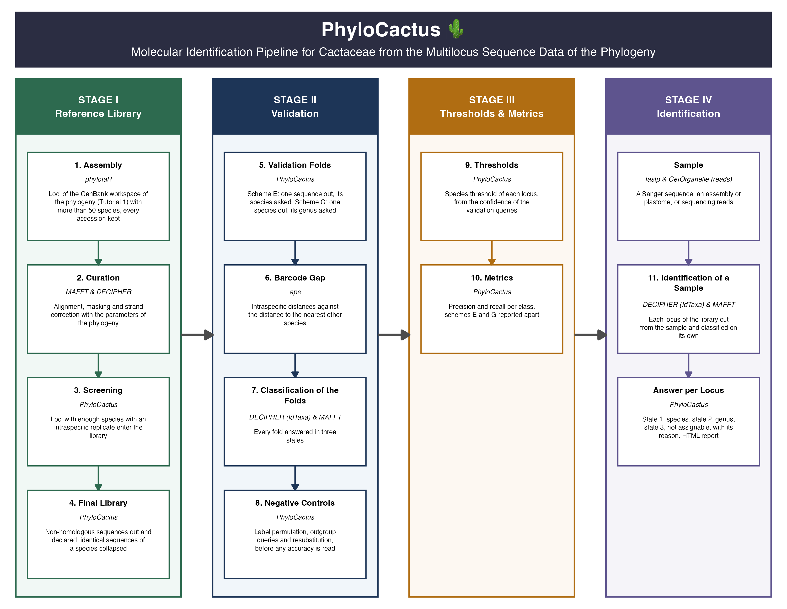
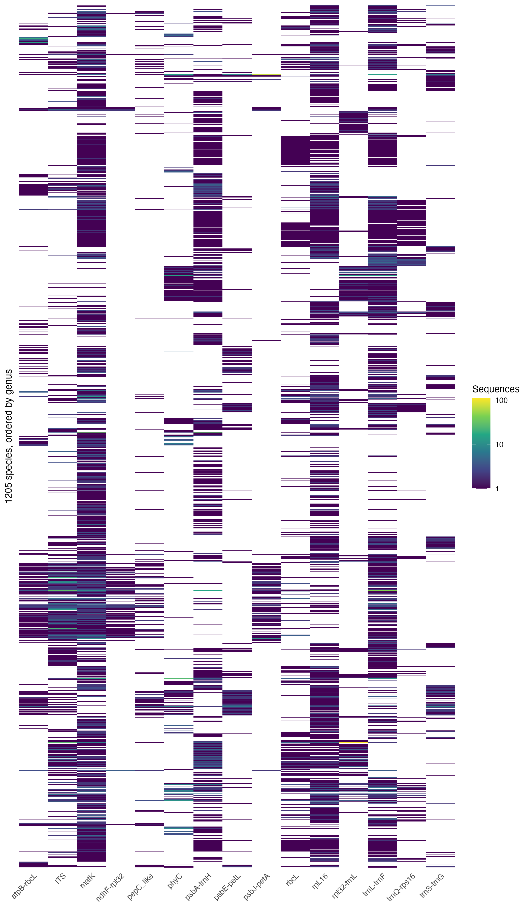
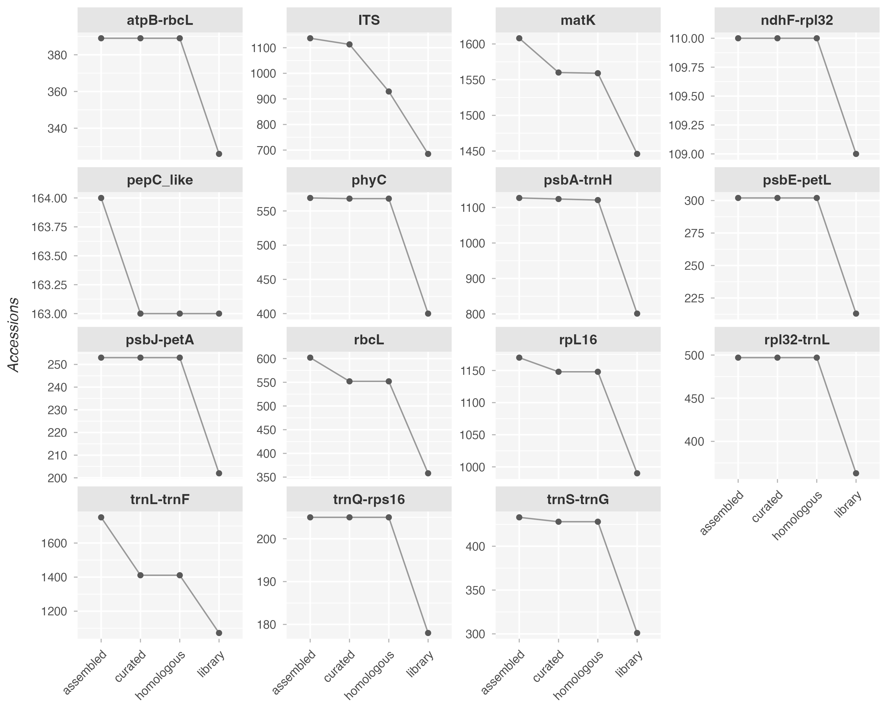
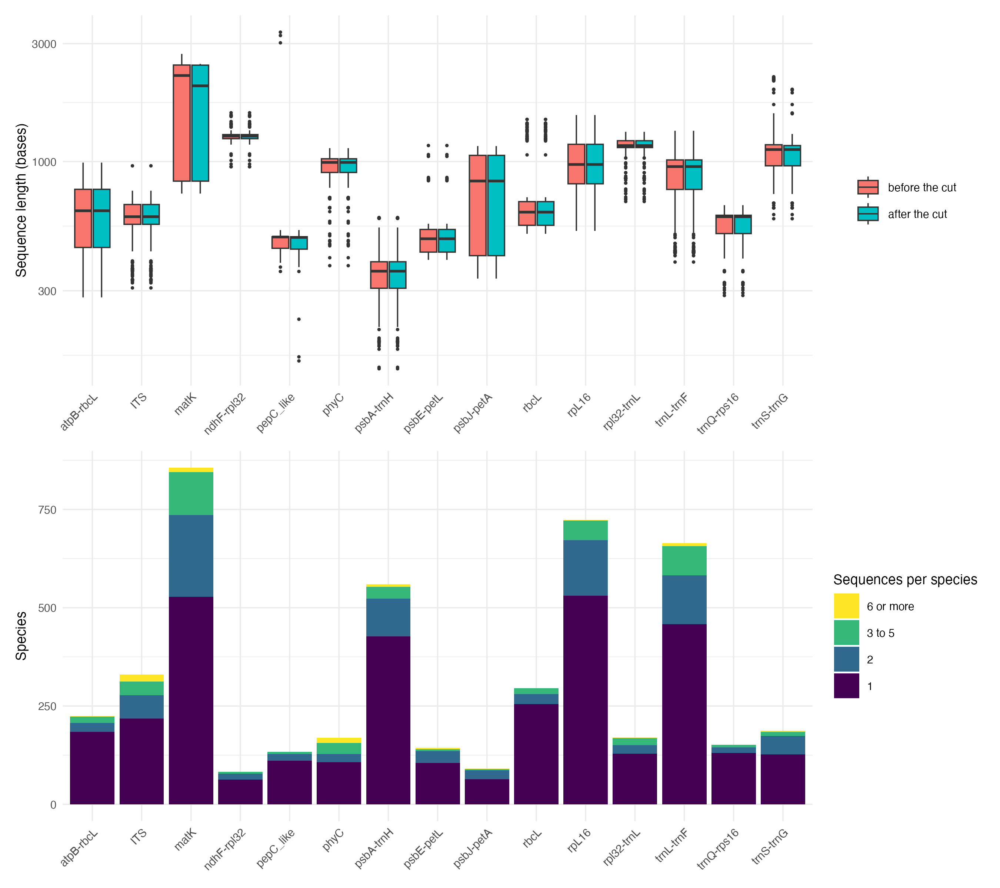
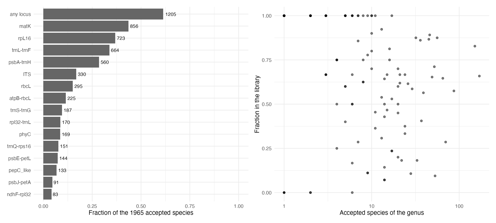
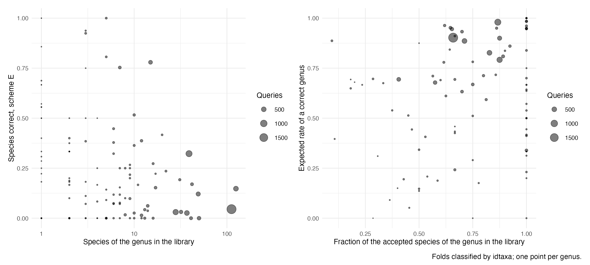
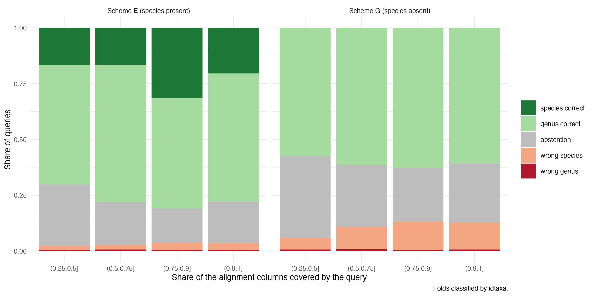
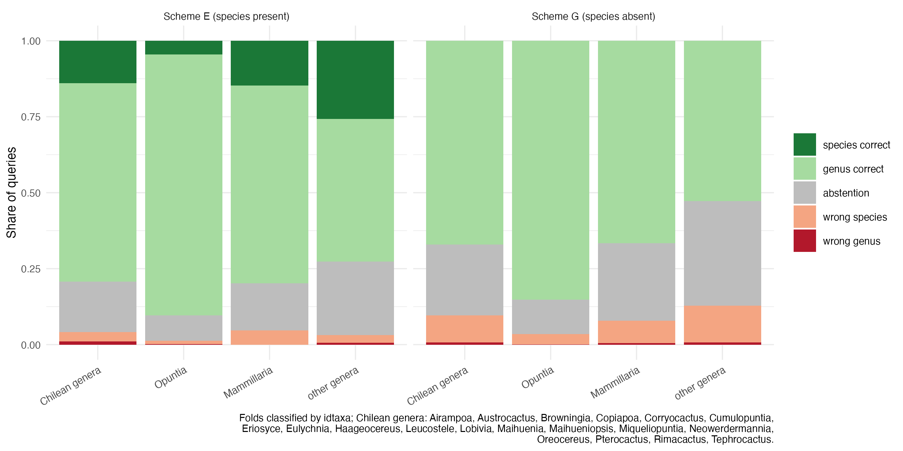

```{r setup, include = FALSE}
knitr::opts_chunk$set(
  collapse = TRUE,
  comment = "#>"
)
```

## Abstract

The barcoding branch of `PhyloCactus` builds a reference library of Cactaceae from Sanger marker records of GenBank (and, optionally, the user's own sequences), measures how well that library tells genera and species apart, and identifies a sample against it.
It answers one question: given a sample of a cactus, to which genus and species does it belong, according to the loci the library holds, and how much can that answer be trusted?

The answer is given locus by locus, in one of three states: a species (state 1), a genus without a species (state 2), or no answer (state 3, with its reason).
Loci are never combined into one verdict; agreement or conflict between loci is reported as such.
The branch identifies against a library of multilocus sequence data; it does not place a sample in a phylogeny.

## Complete Pipeline Execution Workflow

The script, `tutorial-5-cactus-phylogeny-barcoding.R`, runs the eleven steps in order from the tutorial folder of Tutorials 1 to 4 and writes only under `11_barcoding/`. Each step reads the directory written by the step before it and writes its own, so any step can be run again in a new session when the directories it reads exist. Steps 1 to 4 build the library, steps 5 to 10 validate it, and step 11 identifies a sample.

```{r, eval = FALSE}
file.edit(system.file("scripts", "tutorial-5-cactus-phylogeny-barcoding.R", package = "PhyloCactus"))
```

The branch runs in four stages: a reference library built from the multilocus sequence data of the phylogeny (steps 1 to 4), its validation (steps 5 to 8), the thresholds and metrics read from that validation (steps 9 and 10), and the identification of a sample (step 11).

```{r, echo = FALSE, out.width = "100%", fig.cap = "**Figure 1.** The molecular identification branch, from the reference library to the answer for a sample. Steps are numbered as in this tutorial."}

```

### Setup: Creating a Clean Workspace

The branch reads:

- **The phylotaR workspace of the phylogeny** (`0_phylotaR_raw_Ingroup/`, Tutorial 1). Both branches read the same mining; the barcoding branch adds no download of sequences, only the GenBank metadata of the accessions the phylogeny's cache does not hold.
- **The curated files of the package:** the target loci (`target_genes.txt`), the dictionary of locus names (`genes_map.csv`), the manual exclusions (`manual_exclusions_ingroup.csv`, which include 21 `ITS` records annotated in GenBank as pseudogenes) and the checklist of Cactaceae of Caryophyllales.org (Korotkova *et al*. 2021), against which every name is reconciled.
- **Own sequences, optional.** `own_dir = "0_own"` in step 1 adds the records of `0_own/`: a sample sheet (`SAMPLES.csv`: sample, species of the checklist, voucher, publication status) and one FASTA file per locus. What cannot enter is listed with its reason. The default, `own_dir = NULL`, builds the library from GenBank alone.

The library is not distributed with the package: the user builds it with steps 1 to 4.

The script loads the package, moves to the tutorial folder and declares, once, the three switches of its long steps: mail at the end of steps 1 and 7, the folder of the IdTaxa tables computed on a cluster, and the number of parallel processes of step 7.

```{r, eval = FALSE}
library(PhyloCactus)

tutorial_dir <- "~/Desktop/PhyloCactus_Tutorial"
setwd(tutorial_dir)

# -------------------------------------------------------------
# Switches of the long steps, declared once so the whole script is changed from one place.
# -------------------------------------------------------------
# Email when steps 1 and 7 end, whether they finished or failed. FALSE sends nothing and needs no
# configuration. TRUE needs MY_EMAIL in your .Renviron and a blastula credentials file created once
# with blastula::create_smtp_creds_file(). The package reads neither: it hands the path to blastula.
# A notification that cannot be sent is reported and ignored, so it never fails a run.
notify_email <- FALSE

# IdTaxa retrains once per fold, which on the whole library takes tens of core-hours: it is run
# once, on a computing cluster, on the frozen library (generate_barcoding_job_scripts() and
# merge_barcoding_chunks(); CN2 with run_barcoding_controls(method = "idtaxa", controls = "CN2")),
# and its merged tables are the result, since LearnTaxa() differs between machines in floating
# point. This script never trains IdTaxa. NULL leaves IdTaxa out; the path of the folder holding
# the merged tables (TABLE_barcoding_predictions_<scheme>_idtaxa.csv, TABLE_barcoding_timing_idtaxa.csv
# and TABLE_barcoding_cn2_queries_idtaxa.csv) copies them into steps 7 and 8, and steps 9 and 10
# then include IdTaxa.
idtaxa_tables <- NULL

# Parallel processes of this machine for the longest step of the laptop, the nearest neighbour
# through MAFFT --add (step 7). Two cores are left free. Each process writes its log in
# 11_barcoding/7_classifier/chunks/, the progress is in 11_barcoding/7_classifier/PROGRESS_nn_add.txt
# (from a terminal: cat or watch that file), and one email is sent at the end.
n_workers <- max(1L, parallel::detectCores() - 2L)

# Panel tags of the composite figures (TB1, TB4, TB5, TB7), from phylocactus_panel_tags(): A, B by
# default. A journal that asks for A), B) is served by changing this one line to ")".
options(phylocactus.tag_suffix = "")
```

### Step 1: Assembly

**`assemble_barcoding_dataset()`**. The clusters of the mining are named by locus, records over 2000 bases are cut to the extent the shorter records of their locus cover (most of them trnK-matK records cut to `matK`), and every accession is kept with its name reconciled against the checklist (Korotkova *et al*. 2021).

```{r, eval = FALSE}
assemble_barcoding_dataset(
  wd_path = "0_phylotaR_raw_Ingroup",
  output_dir = "11_barcoding",
  target_genes_file = system.file("extdata", "target_genes.txt", package = "PhyloCactus"),
  genes_map_file = system.file("extdata", "genes_map.csv", package = "PhyloCactus"),
  manual_exclusions_file = system.file("extdata", "manual_exclusions_ingroup.csv", package = "PhyloCactus"),
  apply_manual_exclusions = TRUE,
  checklist_path = system.file("extdata", "CactaceaeFullList_2026_07_01_Beatriz_Merino.xlsx", package = "PhyloCactus"),
  min_species = 50,
  preferred_parent = "3593",
  force_download = FALSE,
  notify = notify_email,
  # Own data (O1): NULL leaves them out; "0_own" adds the records of 0_own/ (SAMPLES.csv and one
  # FASTA per locus, headers >sample). What cannot enter is listed in
  # 11_barcoding/1_assembly/TABLE_barcoding_own_left_out.csv.
  own_dir = NULL
)
```

### Step 2: Curation

**`curate_barcoding_markers()`**. Each locus is aligned with `MAFFT`, put on one strand and masked with `DECIPHER`, with the parameters of the phylogeny's ingroup.

```{r, eval = FALSE}
curate_barcoding_markers(
  input_dir = "11_barcoding/1_assembly",
  output_dir = "11_barcoding/2_curated",
  mask_alignment_regions = TRUE,
  min_non_gap_fraction = 0.30,
  max_missing_fraction = 0.30,
  min_masked_alignment_length = 100L,
  preserve_iupac = TRUE,
  fix_strand = TRUE,
  mafft_exec = "mafft",
  mafft_opts = "--auto"
)
```

### Step 3: Screening

**`screen_barcoding_markers()`**. A locus enters the library when 20 or more species hold two or more sequences of it. Saturation and possible paralogy (`pepC_like`) are flagged, never used to exclude.

```{r, eval = FALSE}
screen_barcoding_markers(
  assembly_dir = "11_barcoding/1_assembly",
  curated_dir = "11_barcoding/2_curated",
  output_dir = "11_barcoding/3_screening",
  min_species_with_replica = 20L,
  saturation_flag_cutoff = 0.3,
  paralog_loci = "pepC_like"   # flagged in every table, never excluded
)
```

### Step 4: Final Library

**`finalize_barcoding_library()`**. Non-homologous sequences are excluded and declared, identical sequences of one species are collapsed, and the replication rule is evaluated again on distinct sequences.

```{r, eval = FALSE}
finalize_barcoding_library(
  assembly_dir = "11_barcoding/1_assembly",
  curated_dir = "11_barcoding/2_curated",
  screening_dir = "11_barcoding/3_screening",
  output_dir = "11_barcoding/4_library",
  metadata_file = "11_barcoding/cache/CACHE_GENBANK_METADATA_BARCODING.csv",
  min_species_with_replica = 20L,
  paralog_loci = "pepC_like"
)
```

The library of this version holds 15 loci: `atpB-rbcL`, `ITS`, `matK`, `ndhF-rpl32`, `pepC_like`, `phyC`, `psbA-trnH`, `psbE-petL`, `psbJ-petA`, `rbcL`, `rpL16`, `rpl32-trnL`, `trnL-trnF`, `trnQ-rps16` and `trnS-trnG`.
Built from GenBank records, as a user builds it, it holds 7607 sequences of 1205 species in 139 genera; own sequences can be added through `own_dir` (step 1).
In every locus most species hold a single sequence, which limits what a species answer can rest on.

```{r, echo = FALSE, out.width = "100%", fig.cap = "**Figure 2.** Alignments of `matK` and `ITS` in the library (TB1; the script draws one per locus)."}
knitr::include_graphics(c("figures/Figure_TB1_alignment_matK.png", "figures/Figure_TB1_alignment_ITS.png"))
```

```{r, echo = FALSE, out.width = "100%", fig.cap = "**Figure 3.** Presence of each locus in each species of the library, species ordered by genus (TB2)."}

```

```{r, echo = FALSE, out.width = "100%", fig.cap = "**Figure 4.** From assembly to library, per locus (TB3)."}

```

```{r, echo = FALSE, out.width = "100%", fig.cap = "**Figure 5.** Lengths and replicates per locus (TB4)."}

```

```{r, echo = FALSE, out.width = "100%", fig.cap = "**Figure 6.** Taxonomic coverage of the library against the checklist (TB7; Korotkova et al. 2021)."}

```

### Step 5: Validation Folds

**`build_barcoding_folds()`**. Scheme E leaves one sequence out and asks for its species, which stays in the library; scheme G leaves a whole species out and asks for its genus. The folds are deterministic and checked for leakage.

```{r, eval = FALSE}
build_barcoding_folds(
  library_dir = "11_barcoding/4_library",
  output_dir = "11_barcoding/5_folds"
)
```

### Step 6: Barcode Gap

**`analyze_barcode_gap()`**. Intraspecific distances and the distance to the nearest neighbour of another species, per locus, uncorrected and K80. No locus shows a gap, so no fixed distance threshold is used anywhere in the branch.

```{r, eval = FALSE}
analyze_barcode_gap(
  library_dir = "11_barcoding/4_library",
  output_dir = "11_barcoding/6_gap",
  models = c("raw", "K80"),
  min_comparable = 100L,   # pairs resting on fewer positions have no value
  paralog_loci = "pepC_like",
  figures = TRUE
)
```

### Step 7: Classification of the Folds

**`classify_barcoding_folds()`**. Two classifiers: the nearest neighbour, with each query added to the training alignment of its fold by `MAFFT --add` (hours on a laptop, in parallel processes), and IdTaxa (Murali *et al*. 2018), which retrains once per fold and takes tens of core-hours. IdTaxa is run once, on a computing cluster, on the frozen library (`generate_barcoding_job_scripts()`, `merge_barcoding_chunks()`); the script reads its merged tables through the switch `idtaxa_tables` and never trains it.

```{r, eval = FALSE}
# The branch classifier of the internal validation: exact leave-one-out over the distance matrix
# of the locus, and seconds of running time.
classify_barcoding_folds(
  library_dir = "11_barcoding/4_library",
  folds_dir = "11_barcoding/5_folds",
  output_dir = "11_barcoding/7_classifier",
  method = "nn",
  model = "raw",
  min_comparable = 100L
)

# The same classifier, with every query measured the way a query of a user is measured: stripped of
# gaps, oriented against the training set of its fold and added to it with MAFFT --add --keeplength,
# one call per query. Writes the tables with the suffix _add and the running time per locus. The
# folds are split among n_workers processes and merged into the same tables as one process would
# write. Step 9 reads these tables. Measured on 2026-09-30, Apple M2 Pro, 8 workers, 11 417 queries:
# 3 h 12 min, 24.7 hours summed over the processes, matK 61 % of them.
classify_barcoding_folds(
  library_dir = "11_barcoding/4_library",
  folds_dir = "11_barcoding/5_folds",
  output_dir = "11_barcoding/7_classifier",
  method = "nn",
  alignment = "add",
  workers = n_workers,
  notify = notify_email
)

# The classifier of the real use: IdTaxa needs no alignment, so it is the one that can answer a
# query a user brings. Its tables come from the cluster run (see idtaxa_tables in the SETUP block).
if (!is.null(idtaxa_tables)) {
  file.copy(list.files(idtaxa_tables, pattern = "^TABLE_barcoding_(predictions_(species|genus)|timing)_idtaxa\\.csv$",
                       full.names = TRUE),
            "11_barcoding/7_classifier", overwrite = FALSE)
}
```

### IdTaxa on a Computing Cluster

IdTaxa retrains once per fold, so classifying every fold of the library with it takes tens of core-hours, and `LearnTaxa()` differs in floating point between machines: it is run once, on a computing cluster, and its merged tables are the result. **`generate_barcoding_job_scripts()`** writes the job array (one chunk of folds per task, one core each), the merge job, which runs **`merge_barcoding_chunks()`** once every task has finished, and `submit.sh`, which submits both (`bash submit.sh` on the cluster). The paths are those of the cluster. CN2 with IdTaxa is run there too, with `run_barcoding_controls(method = "idtaxa", controls = "CN2")`.

```{r, eval = FALSE}
generate_barcoding_job_scripts(
  library_dir = "11_barcoding/4_library",
  folds_dir = "11_barcoding/5_folds",
  classifier_dir = "11_barcoding/idtaxa_cluster",
  method = "idtaxa",
  n_chunks = 88L,              # one array task each
  seed = 1L,
  threshold = 60,
  cluster_mem = "24G",         # about 16 GiB at the peak of a task of all loci
  cluster_time = "06:00:00"
)
```

On an earlier library of 12 loci (26-09), the run of all loci took 54.6 core-hours in 88 tasks; the library of this version holds 15. When the merged tables are back, set `idtaxa_tables` in the Setup to their folder (here `11_barcoding/idtaxa_cluster`) and run steps 7 to 10 again: the blocks that read them copy the tables into steps 7 and 8, and steps 9 and 10 then include IdTaxa.

### Step 8: Negative Controls

**`run_barcoding_controls()`** runs the controls before any accuracy is read. CN1 permutes the labels and asks whether the folds leak; CN2 asks the library about sequences of the sister lineages (Anacampserotaceae, Portulacaceae, Talinaceae); CN3 measures the bias of classifying a sequence still in the library. IdTaxa rejects every comparable outgroup query; the rule of remoteness of the nearest neighbour rejects them in six loci but not in `ITS`, where cactus and outgroup distances overlap.

```{r, eval = FALSE}
# CN2 needs an outgroup, assembled from the raw phylotaR workspace of the outgroup with the filters
# of step 1. checklist_path = NA applies no checklist: NULL would load the checklist of Cactaceae
# and discard every outgroup name. No manual exclusions, and no minimum of species per cluster.
# The comparison table is written against the outgroup's own cluster-to-locus assignment.
assemble_barcoding_dataset(
  wd_path = "0_phylotaR_raw_Outgroup",
  output_dir = "11_barcoding/8_controls/outgroup",
  target_genes_file = system.file("extdata", "target_genes.txt", package = "PhyloCactus"),
  genes_map_file = system.file("extdata", "genes_map.csv", package = "PhyloCactus"),
  apply_manual_exclusions = FALSE,
  checklist_path = NA,
  min_species = 0,
  preferred_parent = "3593",
  force_download = FALSE,
  phylogeny_map_file = "1_phylotaR_out_Outgroup/TABLE_CLUSTER_MARKER_ASSIGNMENT_OUTGROUP.csv"
)

# CN2 aligns each outgroup query to the library with MAFFT --add --keeplength, one call per query,
# so MAFFT has to be available. The three controls take about 11 minutes.
run_barcoding_controls(
  library_dir = "11_barcoding/4_library",
  folds_dir = "11_barcoding/5_folds",
  output_dir = "11_barcoding/8_controls",
  outgroup_dir = "11_barcoding/8_controls/outgroup/1_assembly",
  method = "nn",
  permutations = 10L,
  seed = 1L
)
# CN2 with IdTaxa comes from the cluster run, with the tables of step 7
if (!is.null(idtaxa_tables)) {
  file.copy(file.path(idtaxa_tables, "TABLE_barcoding_cn2_queries_idtaxa.csv"), "11_barcoding/8_controls",
            overwrite = FALSE)
}
```

### Step 9: Thresholds

**`sweep_barcoding_threshold()`**. For the nearest neighbour, a threshold of remoteness per locus (quantile 0.99 of scheme G). For IdTaxa, the operating threshold is 60, DECIPHER's default, and a species threshold per locus is written for the identification (rule R-c: the quantile 0.95 of the species confidence of scheme G, never under 60, from 60 in `rbcL` to 91.6 in `trnS-trnG`). A species is named only above it. `rbcL` answers at genus rank only (rule R2, argument `genus_only_loci` of the identification functions): in the probes of this version its species answers were right in 11 of 34.

```{r, eval = FALSE}
sweep_barcoding_threshold(
  classifier_dir = "11_barcoding/7_classifier",
  controls_dir = "11_barcoding/8_controls",
  output_dir = "11_barcoding/9_threshold",
  alignment = "add",
  q = 0.99,
  quantile_type = 1L
)
# IdTaxa: the curve runs over its confidence. The operating threshold is 60, DECIPHER's default
# (decision K7 of 26-09), and step 10 reads that row; the quantile 0.01 of the genus confidence of
# scheme G is reported next to it, not used. The sweep also writes
# TABLE_barcoding_species_threshold_idtaxa.csv: for each locus, the quantile 0.95 of the species
# confidence of scheme G (species absent from the library), never under 60. The identification of
# a user query names a species only above it (rule R-c, Phase 11); the validation stays at 60
if (!is.null(idtaxa_tables)) {
  sweep_barcoding_threshold(
    classifier_dir = "11_barcoding/7_classifier",
    controls_dir = "11_barcoding/8_controls",
    output_dir = "11_barcoding/9_threshold",
    method = "idtaxa",
    quantile_type = 1L
  )
}
```

### Step 10: Metrics

**`summarise_barcoding_metrics()`**. Per locus and scheme: species correct, genus correct, wrong species, wrong genus and unassigned, never summed into one error, and precision and recall per class.

```{r, eval = FALSE}
summarise_barcoding_metrics(
  classifier_dir = "11_barcoding/7_classifier",
  threshold_dir = "11_barcoding/9_threshold",
  library_dir = "11_barcoding/4_library",
  output_dir = "11_barcoding/11_metrics",
  methods = if (is.null(idtaxa_tables)) "nn_add" else c("nn_add", "idtaxa")
)
```

The script then draws the figures of the library and its validation into `11_barcoding/figures/`: the alignment of each locus, species by locus, the funnel from assembly to library, lengths and replicates, accuracy against the sampling of each genus and against missing data, taxonomic coverage against the checklist (Korotkova *et al*. 2021), and the genera native to Chile against *Opuntia* and *Mammillaria*.
The figures of the folds describe the library classifying its own sequences: they are more favourable than the identification of new samples (step 11 and Tutorial 6).

```{r, echo = FALSE, out.width = "100%", fig.cap = "**Figure 7.** Accuracy of the folds against the sampling of each genus (TB5)."}

```

```{r, echo = FALSE, out.width = "100%", fig.cap = "**Figure 8.** Accuracy of the folds against missing data (TB6)."}

```

```{r, echo = FALSE, out.width = "100%", fig.cap = "**Figure 9.** Genera native to Chile against Opuntia and Mammillaria in the folds (TB9)."}

```

### Step 11: Identification of a Sample

**`identify_barcoding_query()`** cuts each locus of the library from the query, classifies it with IdTaxa against the library and gives it one of three states.

```{r, eval = FALSE}
identify_barcoding_query(
  system.file("extdata", "barcoding_example_plastome_MN517611.1.gb", package = "PhyloCactus"),
  library_dir = "11_barcoding/4_library",
  metrics_dir = "11_barcoding/11_metrics",
  threshold_dir = "11_barcoding/9_threshold",
  output_dir = "11_barcoding/10_identify",
  run_name = "MN517611.1"
)
print(utils::read.csv("11_barcoding/10_identify/TABLE_barcoding_identify_MN517611.1.csv")[
  , c("locus", "state", "predicted_species", "predicted_genus", "genus_confidence", "species_confidence",
      "species_threshold", "reason")])

# Your own samples take the same call or one of the three below. They need your files, and the reads
# need fastp and GetOrganelle on the PATH (minimap2 and samtools for an assembly), so they are shown
# here and not run.
# Several samples at once, from a sample sheet (sample_id, input_type, file_1 and, for reads, file_2):
# identify_barcoding_samples("my_samples.csv")
# An assembly (FASTA, plain or gzipped), from which the library loci are mapped and cut:
# identify_barcoding_assembly("my_assembly.fasta", run_name = "my_assembly")
# Paired Illumina reads (genome skim or whole-genome sequencing): plastome and nrDNA are assembled,
# then identified locus by locus:
# identify_barcoding_reads("my_run_1.fastq.gz", "my_run_2.fastq.gz", run_name = "my_run")
```

`identify_barcoding_query()` takes one or more sequences (FASTA, a GenBank flat file, a `DNAStringSet` or a character vector) and, for each locus of the library:

1. finds the locus in the query by its 20-mers, on both strands, and crops it from a long query such as a plastome;
2. cuts the region to the core of the locus, so that segments held by one or two references cannot name them;
3. classifies it with IdTaxa trained on the whole library of the locus, and, when a genus is reached, again on the core of that genus;
4. returns state 1 only above the species threshold of the locus (R-c), state 2 when the genus confidence reaches 60, and state 3 otherwise, with its reason (`no_overlap`, `short_overlap` or `low_confidence`).

A self-contained HTML report is written beside the table, with the answer per locus, the agreement between loci, the alternatives under the thresholds, the sampling of the genus in the library and the provenance of the run (input, software, library checksums).
The example is the plastome of *Mammillaria zephyranthoides* (GenBank MN517611.1), distributed with the package: it is named to species from `matK`, and the other loci give no answer.

The same answer is available for other kinds of input:

- **Several samples** from a sample sheet: `identify_barcoding_samples()`.
- **An assembly** (FASTA): `identify_barcoding_assembly()`, which maps the library loci with `minimap2` and `samtools`.
- **Paired Illumina reads** (genome skim or whole-genome sequencing): `identify_barcoding_reads()`, which assembles the plastome and the nuclear ribosomal DNA with `fastp` and GetOrganelle, then identifies them locus by locus. Reads are a query, not a source of the library.

[Tutorial 6](https://beeamerino.github.io/PhyloCactus/articles/tutorial-6-cactus-barcoding-identification.html) identifies public samples of each of these kinds of input, shows their reports, and gives the rates measured with this version.

### Tables of the Run

The script prints the tables of each step: the screening, the library and its funnel, the folds, the barcode gap, the controls, the thresholds and the metrics.

```{r, eval = FALSE}
print(utils::read.csv("11_barcoding/3_screening/TABLE_barcoding_marker_screening.csv"))
print(utils::read.csv("11_barcoding/4_library/TABLE_barcoding_library_summary.csv"))
# Accessions and decisions per locus, from assembly to library
print(utils::read.csv("11_barcoding/4_library/TABLE_barcoding_funnel.csv"))
# Species and genera inside and outside the denominator, per locus and scheme
print(utils::read.csv("11_barcoding/5_folds/TABLE_barcoding_folds_summary.csv"))
# Barcode gap per locus and model, with the candidate threshold and its decision
print(utils::read.csv("11_barcoding/6_gap/TABLE_barcoding_gap_summary.csv"))
# Negative controls: leakage verdict per locus and scheme, and the outgroup queries per locus
print(utils::read.csv("11_barcoding/8_controls/TABLE_barcoding_cn1_verdict.csv"))
print(utils::read.csv("11_barcoding/8_controls/TABLE_barcoding_cn2_outgroup.csv"))

# Threshold of remoteness per locus and scheme, with the outgroup rejection where it is measured
print(utils::read.csv("11_barcoding/9_threshold/TABLE_barcoding_threshold_operating.csv"))
# Metrics per locus and scheme
print(utils::read.csv("11_barcoding/11_metrics/TABLE_barcoding_metrics_summary_nn_add.csv"))
```

## Limitations

- **Wrong species.** Rare, not absent; [Tutorial 6](tutorial-6-cactus-barcoding-identification.html#how-well-this-version-identifies) gives the rates of this version for each kind of input. Most are congeners named with high confidence when the true species is absent from the library or shares its haplotype.
- **Abstention.** The common answer of this version. Plastid loci of closely related cacti differ little, most species are represented by one sequence per locus, and IdTaxa withholds an answer rather than guess.
- **One locus, one answer.** A species answer usually rests on a single locus, mostly `matK`. The agreement between loci, given in the report, is the main check a user has.
- **`ITS` and the nearest neighbour.** The rule of remoteness of the nearest neighbour does not reject the sister lineages in `ITS`. The identification runs IdTaxa, which rejects them; the nearest neighbour is used only in the internal validation.
- **Coverage.** The library holds 1205 of the accepted species of the checklist (Korotkova *et al*. 2021); a sample of a species or genus outside a locus library can only be named as something else in that locus (Tutorial 6 gives examples).

## Design Decisions

The manifest of this section in version 0.4.5 left five questions open. The phases of version 0.5.0 answered them:

1. **Loci and combinations.** Each locus is classified on its own; loci are not concatenated and no combination of loci is evaluated as a unit (amendment E8 of the validation plan).
2. **Unit of assignment.** A graded answer per locus: species, genus or none, with the reason for none. A species is named only above the species threshold of its locus (R-c, 2026-10-06).
3. **Reporting ambiguity.** The candidates under the thresholds are listed as alternatives in the report, never promoted to an answer; disagreement between loci is reported as a conflict.
4. **Genome skims and other reads.** The library is built from Sanger marker records of GenBank and own sequences, and genome skims are not a source of it (2026-10-07). Illumina reads that a user brings are a query: `identify_barcoding_reads()` assembles their plastome and nuclear ribosomal DNA and identifies them against the library, locus by locus.
5. **Paralogy and organelle capture.** Possible paralogs (`pepC_like`) and saturation are flagged and kept; conflict between plastid and nuclear loci is reported as disagreement between loci, not resolved. Per-locus monophyly and the cytonuclear diagnosis are planned for version 0.6.

[Continue to Tutorial 6: Identifying a Sample](https://beeamerino.github.io/PhyloCactus/articles/tutorial-6-cactus-barcoding-identification.html)

## References

- Korotkova *et al*. 2021. Cactaceae at Caryophyllales.org - A dynamic online species-level taxonomic backbone for the family. *Willdenowia*, 51(2), 251–270. <https://doi.org/10.3372/wi.51.51208>
- Murali, A., Bhargava, A. & Wright, E. S. 2018. IDTAXA: a novel approach for accurate taxonomic classification of microbiome sequences. *Microbiome*, 6. <https://doi.org/10.1186/s40168-018-0521-5>
